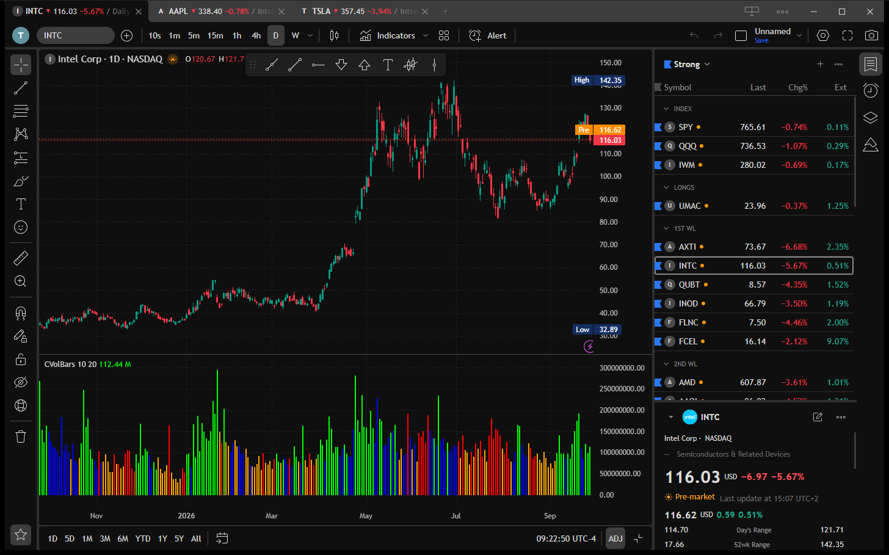

<p align="center">
  
</p>

# OpenTrader

**Website:** [opentrader.markets](https://opentrader.markets/) · [Download](https://opentrader.markets/download.html) · [Online demo](https://demo.opentrader.markets/) · [Community](https://community.opentrader.markets/)

**An attempt at an open trading app.** OpenTrader is a free, open-source desktop charting application built for speed. It is an open-source alternative to commercial trading software, out in the open for anyone to read, run, and extend.

It is an early work in progress: some features are stubbed or partially wired. Contributions, issues, and ideas are welcome.



> **Disclaimer:** OpenTrader is an independent project, not affiliated with any commercial trading platform or data provider. It is for charting and research only and is **not financial advice**. Provided "as is", without warranty. See [LICENSE](LICENSE).

> [!WARNING]
> **Market data is delayed by 15 minutes for now.** Once sponsoring starts, we will be able to support live streaming data. See [Support the project](#support-the-project).
>
> **Second and minute history is limited to 5 years.** Daily history goes back to 2003.

## Download

Download the installer for your system and run it. Nothing else to set up: no account, no API key, no token. Market data works out of the box.

| OS | Download |
|---|---|
| Windows | [Installer (.exe)](https://github.com/deepentropy/opentrader/releases/latest/download/OpenTrader_windows_x64-setup.exe) or [.msi](https://github.com/deepentropy/opentrader/releases/latest/download/OpenTrader_windows_x64.msi) |
| macOS (Intel and Apple Silicon) | [Disk image (.dmg)](https://github.com/deepentropy/opentrader/releases/latest/download/OpenTrader_darwin_universal.dmg) |
| Linux | [.AppImage](https://github.com/deepentropy/opentrader/releases/latest/download/OpenTrader_linux_amd64.AppImage), [.deb](https://github.com/deepentropy/opentrader/releases/latest/download/OpenTrader_linux_amd64.deb) or [.rpm](https://github.com/deepentropy/opentrader/releases/latest/download/OpenTrader_linux_x86_64.rpm) |

All versions and release notes: [GitHub Releases](https://github.com/deepentropy/opentrader/releases).

The installers are not signed with a paid certificate:

- **Windows:** SmartScreen may show "Windows protected your PC". Click *More info*, then *Run anyway*.
- **macOS:** the app is ad-hoc signed. On first launch macOS blocks it. Open *System Settings > Privacy & Security* and click *Open Anyway*.

Windows is the main development platform. The macOS and Linux builds are produced by the same code but are less tested.

## Use with a coding agent

A coding agent (Claude Code, Claude Desktop, Codex, Cursor, …) can work with the running app: read your charts, add indicators, write and test scripts, run strategies, draw, screen the market and save screens, manage watchlists, alerts and layouts, read the Community, and take screenshots of the result. It cannot place orders or post in the Community.

1. In the app, open *Settings > Coding agents* and tick *Allow coding agents to use OpenTrader*. The app then listens on this computer only (`http://127.0.0.1:47821/mcp`), and only for requests that carry its token.
2. Copy the setup for your agent from the same page. For Claude Code it is one command:

```bash
claude mcp add --transport http opentrader http://127.0.0.1:47821/mcp --header "Authorization: Bearer <token>"
```

Claude Desktop only starts servers from a command, so its setup bridges to the app with `mcp-remote` (needs Node.js). Add the `opentrader` entry to `mcpServers` in `claude_desktop_config.json`, keeping the servers already there:

```json
{
  "mcpServers": {
    "opentrader": {
      "command": "npx",
      "args": ["-y", "mcp-remote", "http://127.0.0.1:47821/mcp", "--header", "Authorization:${OT_AUTH}"],
      "env": { "OT_AUTH": "Bearer <token>" }
    }
  }
}
```

Claude Desktop connects only when it starts: restart it once the app runs with coding agents allowed.

The agent acts on the chart tab you focused last; every change is an undo step. The app also gives the agent the guides of the scripting, indicator and drawing libraries, so you can ask in plain words, for example "write an indicator that colours the bars by RSI and add it to my chart".

## Support the project

OpenTrader is free, but running it is not: market data, servers and development tools are paid every month. Donations pay these costs. Only the monthly total is published.

[](https://github.com/sponsors/deepentropy)

- [Sponsor on GitHub](https://github.com/sponsors/deepentropy)
- [Buy Me a Coffee](https://buymeacoffee.com/opentrader)

The same status is in the app: *Settings > About*.

## Build from source

### Prerequisites

- Rust stable: https://rustup.rs/
- Node.js 22 or newer (npm)
- Tauri system dependencies for your OS: https://v2.tauri.app/start/prerequisites/
  (Windows: MSVC Build Tools and WebView2; Linux: `libwebkit2gtk-4.1-dev` and friends; macOS: Xcode Command Line Tools)

### Get the code

The drawing core is read from a sibling folder, so clone both repositories side by side:

```bash
git clone https://github.com/deepentropy/opentrader.git
git clone https://github.com/deepentropy/lightweight-charts-drawing.git
cd opentrader
npm ci
```

### Market data token (source builds only)

The released installers already contain the gateway token. Only a build from source needs one: market data goes through the OpenTrader gateway, and the app token is compiled into the build. Copy `.env.example` to `.env` and set `OPENTRADER_GATEWAY_TOKEN`, or set it as an environment variable. A build without a token runs, but charts get no data. `.env` is gitignored: never commit it.

### Run and build

```bash
npm run tauri dev      # opens the app with hot reload
npm run tauri build -- --no-sign   # installers under src-tauri/target/release/bundle/
```

The first run is slow (cold Rust build, a few minutes). Later runs take seconds.

`--no-sign` skips the signing of the in-app update files, which needs the project's private key. A build without it runs normally.

`src/bindings.ts` is written on each debug run of the app. For a release build from a fresh clone, generate it first with `cargo test --lib export_bindings` in `src-tauri/`. Do not edit it by hand.

## Layout

```
src/                  frontend (window/, components/, data/, styles/, assets/, agent/)
src-tauri/            backend and app config
docs/assets/          README images
.github/workflows/    release build
```

## Release

1. The [Prepare release workflow](.github/workflows/prepare-release.yml) bumps `oakscriptjs`, `lightweight-charts-indicators` and the drawing core (`config.drawingRef` in `package.json`) to their latest release, bumps the app version, runs the checks, then commits, tags and pushes to `main`. It runs daily (releases only when a library has a new version) and from the Actions tab with "Run workflow" (also releases new commits since the last tag).
2. The [Release workflow](.github/workflows/release.yml) then builds Windows, macOS and Linux installers into a release for the tag, with notes from the commits, and publishes it once all three are built. A manually pushed version tag (`git tag v0.1.0 && git push origin v0.1.0`) runs the same build.
3. Installed apps (Windows and macOS) find the new version at their next start or within an hour, download it, and offer "Update the app".

The workflow needs the repository secrets `OPENTRADER_GATEWAY_TOKEN`, `TAURI_SIGNING_PRIVATE_KEY` and `TAURI_SIGNING_PRIVATE_KEY_PASSWORD` (update signing key; its public key is `plugins.updater.pubkey` in `src-tauri/tauri.conf.json`).

## Third-party notices

OpenTrader uses [TradingView Lightweight Charts™](https://github.com/tradingview/lightweight-charts), licensed under the Apache License 2.0:

> TradingView Lightweight Charts™  
> Copyright (с) 2025 TradingView, Inc. https://www.tradingview.com/

Emoji images: [Twemoji](https://github.com/jdecked/twemoji) graphics, Copyright 2019 Twitter, Inc and other contributors, licensed under [CC-BY 4.0](https://creativecommons.org/licenses/by/4.0/) (from the `@twemoji/svg` package).

## License

[MIT](LICENSE)
